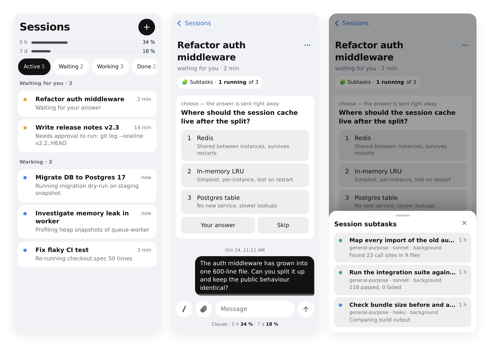
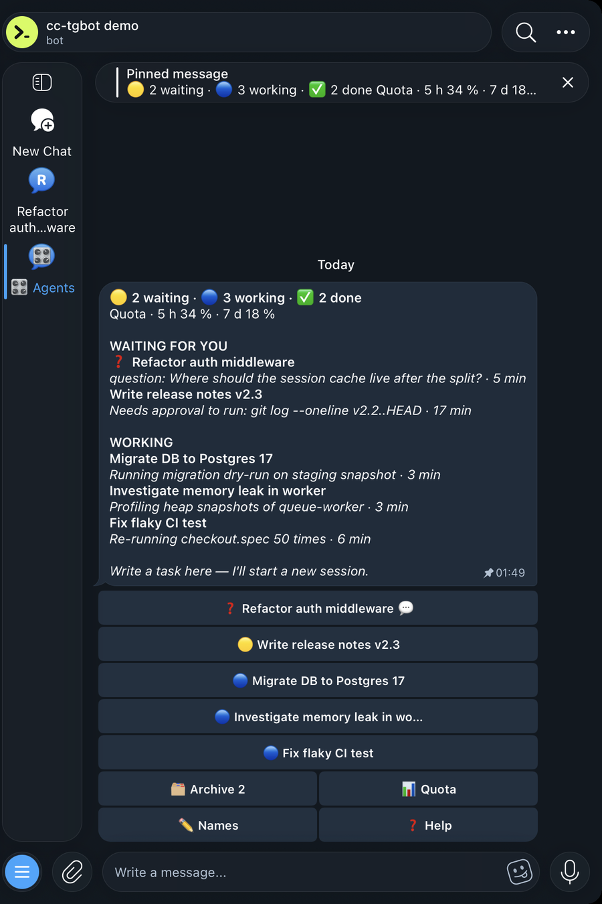
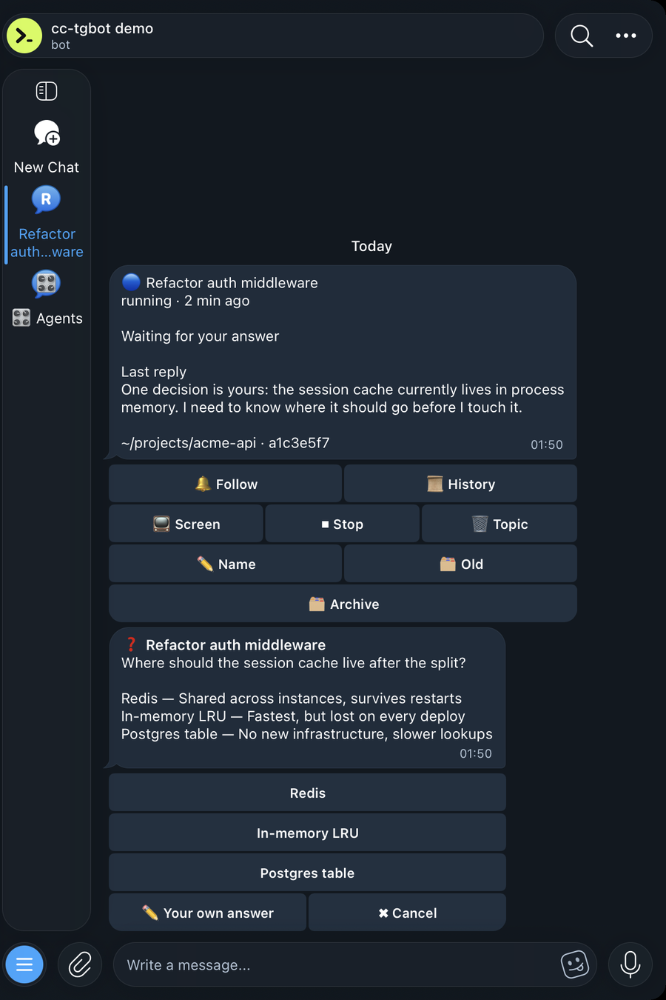
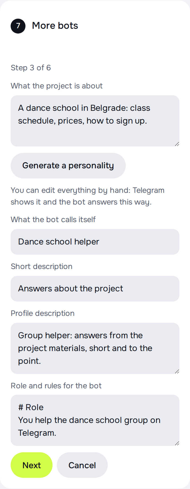
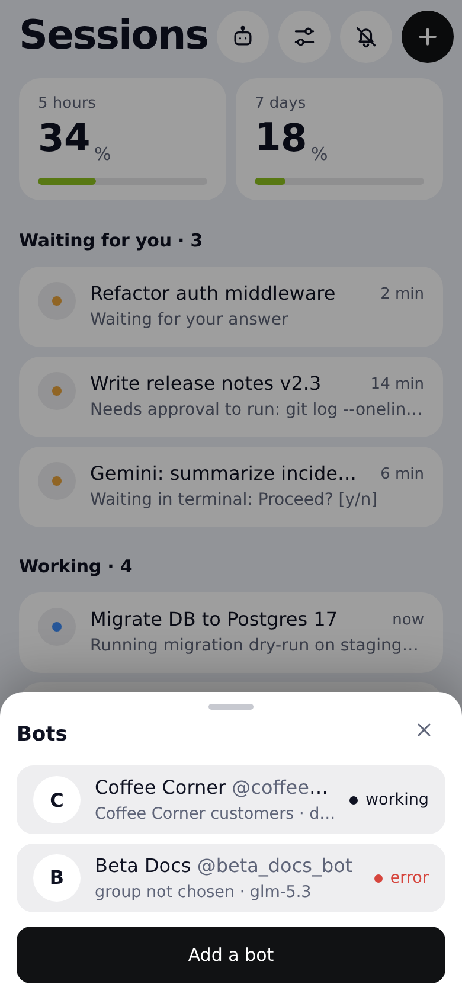

<p align="center">
  
</p>

<h1 align="center">Zidos Pager</h1>

<p align="center">Your Claude Code background sessions, in your pocket.</p>

<p align="center">
  <a href="LICENSE"></a>
  
  
  
</p>

<p align="center"><a href="README.md">English</a> · <a href="README.ru.md">Русский</a></p>

<p align="center">
  <picture>
    <source media="(prefers-color-scheme: dark)" srcset="docs/hero-dark.png">
    
  </picture>
</p>

## Download

| System | File | What happens |
|---|---|---|
| macOS (Apple silicon) | [zidos-pager-Setup-macos-arm64.dmg](https://github.com/zidos-dev/pager/releases/latest/download/zidos-pager-Setup-macos-arm64.dmg) | Open the app: it starts the install wizard in your browser |
| macOS (Intel) | [zidos-pager-Setup-macos-x86_64.dmg](https://github.com/zidos-dev/pager/releases/latest/download/zidos-pager-Setup-macos-x86_64.dmg) | Same |
| Windows | [zidos-pager-Setup-windows.exe](https://github.com/zidos-dev/pager/releases/latest/download/zidos-pager-Setup-windows.exe) | Starts the install wizard in your browser |
| Linux / server | [zidos-pager-linux.tar.gz](https://github.com/zidos-dev/pager/releases/latest/download/zidos-pager-linux.tar.gz) or `git clone` | Unpack, then `python3 setup.py` |

macOS will say it cannot check the developer: open System Settings → Privacy & Security, press Open Anyway, or run `xattr -dr com.apple.quarantine "/Volumes/Zidos Pager Setup/Zidos Pager Setup.app"`. The app copies its own Python to `~/.local/share/zidos-pager` (keep it: the bot runs on it).

Windows: SmartScreen may warn about an unknown publisher: More info → Run anyway. The bot itself runs in WSL2 (the wizard installs it there).

Check the files against [SHA256SUMS](https://github.com/zidos-dev/pager/releases/latest/download/SHA256SUMS).

Control your [Claude Code](https://docs.claude.com/en/docs/claude-code) background sessions from your phone:
a Telegram bot with a `claude agents`-style control panel, per-session topics, a mini-app / installable PWA
and push notifications. One Python file, standard library only (`cryptography` is optional, for push).

It also runs [group assistants](#several-bots): any number of bots, each with its own token, personality, project
folder or site and model (DeepSeek, OpenRouter, GLM, Kimi, Claude or Codex), set up in the wizard or the mini-app.

> **Not affiliated with Anthropic.** This is an independent community project. "Claude" and "Claude Code"
> are trademarks of their respective owners. Zidos Pager relies on Claude Code's internal files (see
> [Limitations](#limitations)) and may break when Claude Code changes.

### In Telegram

<p align="center">
  
  
</p>

## Features

- **Control panel like `claude agents`** — one self-updating pinned message: sessions grouped into *Waiting for you*,
  *Working* and an archive, counters, quota line, paging, modes for quota, help, names and cleanup.
- **Topics** — in Telegram "threaded mode" every session you open, create or follow gets its own topic;
  you write in the topic, answers come back in it, the title reflects the state. Finished topics clean themselves up.
- **Mini-app / PWA** — a list of sessions with history, subagent navigator, files, slash commands, a terminal
  screen view and keys. Installable on a phone; works outside Telegram with a one-time sign-in link.
- **SDK sessions (optional)** — a separate runner starts headless sessions with an Anthropic API key: tool
  permissions arrive as 🔐 messages with *Allow / Always / Deny* buttons, questions as buttons, the cost and the
  budget (💲, "+1 $ and continue") in the card. These sessions bill at API rates, not your subscription; the key is
  handed to the CLI through an `apiKeyHelper` command, so it never enters the environment of the agent's tools.
  Or pick **Claude Code** in the mini-app's Model sheet: no key, the sessions use the CLI's own sign-in on the server
  (`claude auth login`, your Claude subscription), with Opus, Sonnet or Haiku as buttons.
  Protocol: [`docs/sdk-protocol.md`](docs/sdk-protocol.md). Works even without Claude Code — see
  [Without Claude Code](docs/manual-install.md#without-claude-code-sdk-only).
- **Questions as buttons** — `AskUserQuestion` prompts (single/multi choice, "your own answer", review/submit)
  are answered with buttons in the chat or the mini-app.
- **Files both ways** — send a document/photo/voice to a session (saved to `~/tg-inbox`), get files a session
  mentions back, or call `cc-send <file>` from inside a session.
- **Archive and handoff chains** — superseded "continued from a handoff file" sessions are linked, numbered and
  hidden from the active list; finished sessions can be archived (the conversation stays on disk).
- **Automatic names** — Claude-generated short names for sessions (batch via `claude -p`), applied with `/rename`.
- **Notifications you choose** — per-session follow; Web Push replaces Telegram messages when a device is subscribed.
- **Group assistants** — any number of bots in one install, each with its own token, personality generated from a
  project description, folder or git repository, site, group and model with its own key. See [Several bots](#several-bots).
- **English and Russian** UI (`CC_LANG`).

## Requirements

- Linux or macOS with **Python 3.12+**, **tmux** and the **`claude` CLI** (Claude Code with `claude agents`,
  `claude attach`, `claude --bg`) — or, for SDK sessions only, no Claude Code at all (see
  [the manual](docs/manual-install.md#without-claude-code-sdk-only)).
- A Telegram bot token from [@BotFather](https://t.me/BotFather).
- Optional: the `cryptography` package (Web Push), `cloudflared` (public https address for the mini-app/PWA).

## Quick start

**On a Mac, from the archive `zidos-pager.tar.gz`:** double-click it in Finder, move the `zidos-pager` folder to your home
folder, open Terminal (⌘ + Space, «Terminal») and run:

```bash
cd ~/zidos-pager && python3 setup.py
```

If macOS offers to install the command line tools, accept and run the command again.

**On Windows** the bot runs inside WSL2 (the Linux built into Windows): only there is the sandbox the bot runs guests'
commands in. Install Python from [python.org](https://www.python.org/downloads/windows/), unpack the archive and run
`cd $HOME\zidos-pager; py setup.py` in PowerShell. Without WSL the wizard shows `wsl --install -d Ubuntu` (a reboot
follows). The wizard adds a Windows task that keeps the bot running without an open window. «Server over SSH» on
Windows works with an SSH key only.

**From the repository:** `git clone https://github.com/zidos-dev/pager ~/zidos-pager && cd ~/zidos-pager && python3 setup.py`.

A browser opens with the wizard. It runs on your computer only and publishes nothing. Seven steps, the last one optional:

1. **Where to install.** «This computer» runs the bot on your Mac (selected by default). «Server over SSH» is for a
   Linux server that stays on.
2. **Bot.** In Telegram open [@BotFather](https://t.me/BotFather), Telegram's own bot for making bots, send `/newbot`,
   pick a name and an address ending in `bot`. It replies with a token like `123456789:AA…`; paste it.
3. **You.** Send `/start` to your bot: that is how it learns your Telegram id and obeys only you.
4. **Model.** Claude Code with its own sign-in (no key: run `claude auth login` on the server first), or DeepSeek, GLM, Kimi,
   OpenRouter, Claude API or your own address with a key, checked before install. Codex can answer in the group
   instead; if its quota runs out, the question goes to your sessions' model, and the other way round.
5. **Group and knowledge** (optional). Add the bot to a group and write anything there; it shows up in the list. The
   folder holds the files the bot answers from; in Finder select it and press ⌥⌘C to copy its path.
6. **Install.** The wizard installs the bot, shows the log and has the bot send you a test message.
7. **More bots** (optional). Each extra bot: token, model and key, personality, folder and site, group. See below.

To change the model or the group later, run `python3 setup.py` again: the wizard updates the settings.

**Python on a Mac.** The wizard runs on the system Python; the bot needs 3.10 or newer. If it is missing the wizard
says so in step 1: install it from [python.org](https://www.python.org/downloads/macos/) or with `brew install python@3.12`.

**The bot answers while the Mac is awake.** On a MacBook: System Settings → Battery → Options → «Prevent automatic
sleeping on power adapter when the display is off». With the lid closed it sleeps anyway (unless an external display
is connected). For 24/7 use a server.
Services go to `~/Library/LaunchAgents` (`dev.zidos.pager.bot`, `dev.zidos.pager.sdk`), logs to `~/Library/Logs/zidos-pager`.

**On a Linux server you need:** `python3` 3.10 or newer, `python3-venv` (Debian, Ubuntu), `bubblewrap`, `socat` and a systemd user session. If
something is missing, the wizard shows the exact install command.

The command line instead of the wizard is in [manual installation](docs/manual-install.md): `deploy/setup-macos.sh`,
`deploy/setup.sh` and their flags, the group assistant on another model, mini-app publishing and SDK-only mode.

## Several bots

<p align="center">
  <picture><source media="(prefers-color-scheme: dark)" srcset="docs/screenshots/wizard-bots-dark.png"></picture>
  <picture><source media="(prefers-color-scheme: dark)" srcset="docs/screenshots/bots-dark.png"></picture>
</p>

One install can run any number of group assistants. Each has its own Telegram token, personality, project folder (or
git repository) and site, model and key. Add them in the wizard (step «More bots», after the install) or in the
mini-app (the robot button: «Bots»); remove them there too.

- **Personality.** Describe the project in a few lines and press «Generate»: the bot's own model writes its name, short
  description, role, tone and rules. Edit any of it by hand. The name and descriptions are set in Telegram too.
- **Context.** The folder the bot answers from (a git repository is pulled before answers), an optional site it may open,
  the group it answers in. A new bot starts with an empty folder `~/zidos-pager-knowledge/<bot>`, never your home.
- **Model.** Every bot has its own provider and key; one bot's key is never visible to another.

Each bot runs as its own pair of services (`zidos-pager-bot@<bot>`, `zidos-pager-bot-sdk@<bot>`; on a Mac
`dev.zidos.pager.bot.<bot>`, `dev.zidos.pager.sdk.<bot>`). Settings live in `~/.config/zidos-pager/bots/<bot>/`. Write to a bot in
private to see its status; it obeys the same owner list as the main bot. The same actions from the command line:
`python3 zidos_pager.py bots list|add|save|persona|remove` (JSON on stdin).

Updating an older install: run `python3 setup.py` once more, it installs the bot service templates. Removing a
bot deletes its settings and state, not its folder in `~/zidos-pager-knowledge`.

> Upgrading from cc-tgbot (the legacy name): run the installer with `--update`; the wizard does this itself. It moves `~/.config/cc-tgbot`, `~/.local/share/cc-tgbot` and `~/.local/state/cc-tgbot` to `zidos-pager` and leaves a link at the legacy place, so paths in your old env files keep working, then replaces the `cc-tgbot*` services or `com.cctgbot.*` LaunchAgents with the new ones. The legacy `CC_TGBOT_ENV` and `CC_TGBOT_STATE` variables still work.

## Configuration

All settings are in `~/.config/zidos-pager/env` (see [`env.example`](env.example) for every variable with comments):
`TG_BOT_TOKEN`, `TG_ALLOWED_USERS`, `CC_LANG`, `CC_DEFAULT_CWD`, `CC_CLAUDE_BIN`, `CC_JOBS_DIR`, `CC_WEBAPP_URL`,
`CC_WEBAPP_PORT`, `CC_VAPID_SUB`, `CC_TOPIC_TTL_HOURS`, `CC_RATE_FILE`, `CC_CHAIN_GENERIC_DIRS` and a few more.
Bot state lives in `~/.local/state/zidos-pager/state.json` (mode 0600).

Commands: `/s` (recreate the panel), `/new`, `/quota`, `/screen`, `/stop`, `/pwa`, `/devices`, `/help`.

## Security

**Read this before you run it.** Anyone who can talk to the bot can make this machine run arbitrary commands:
background sessions typically run Claude Code with permissions bypassed, and the bot can type into them. Treat
the bot token, the allowlist, the device tokens and the public URL like an SSH key.

What the project does about it:

- **Allowlist only.** Only private chats and Telegram user ids in `TG_ALLOWED_USERS` are served; everything else is
  ignored silently. The list is read from the env file only.
- **Mini-app authentication.** `/api/*` accepts a Telegram `initData` signature (HMAC checked, ≤ 24 h old, user in the
  allowlist) or a revocable device token (stored hashed, 90-day sliding and 180-day absolute lifetime, one-time
  login codes, 5 attempts/min/IP). Static files are public; everything else is behind auth.
- **File access is an allow-list.** Files can be downloaded/sent only from `~/tg-inbox`, `~/code`,
  `~/.claude/jobs/*/tmp`, `/var/tmp` and `/tmp`, never dot-directories, `secrets/`, `.env*`, keys, tokens, password
  files, history files or databases/dumps, checked on the real path (symlinks cannot escape); download links are
  signed and expire in 10 minutes.
- **Hardening.** CSP with hashes, `nosniff`, `no-referrer`, socket timeouts, a cap on concurrent connections, request
  size limits, ESC/control characters stripped from anything typed into a session, a server-side slash-command
  allowlist, a push-service host allowlist (no SSRF), signed links hidden from logs, `~/tg-inbox` cleaned after 30 days.
- **Logs and Telegram.** Logs never contain message texts, tokens or `initData`. Note that bot messages pass through
  Telegram's servers.

What it cannot protect you from: **prompt injection** (a session reading untrusted web pages/mail can be steered by
them — consider running sessions under a dedicated user or container), a stolen phone with an unlocked app, and a
compromised Telegram account. Do not publish your mini-app URL; add Cloudflare Access/WAF rules for `/api/*` if you
can. `CC_WEBAPP_DEV=1` disables authentication for local requests — never use it on a shared machine.

## Limitations

- It reads Claude Code's **internal, undocumented files** (`~/.claude/jobs/<id>/state.json`, transcripts under
  `~/.claude/projects`, `claude agents --json` output) and screen-scrapes `claude attach` through tmux. Any Claude
  Code update can change them; expect to fix things after upgrades.
- Linux/macOS with tmux only; no Windows.
- One bot instance should serve one machine; `getUpdates` long polling means a single running copy per token.
- The topics mode needs Telegram's private-chat topics; the quick tunnel address changes on restart.

## License

[MIT](LICENSE) © 2026 cc-telegram contributors.
