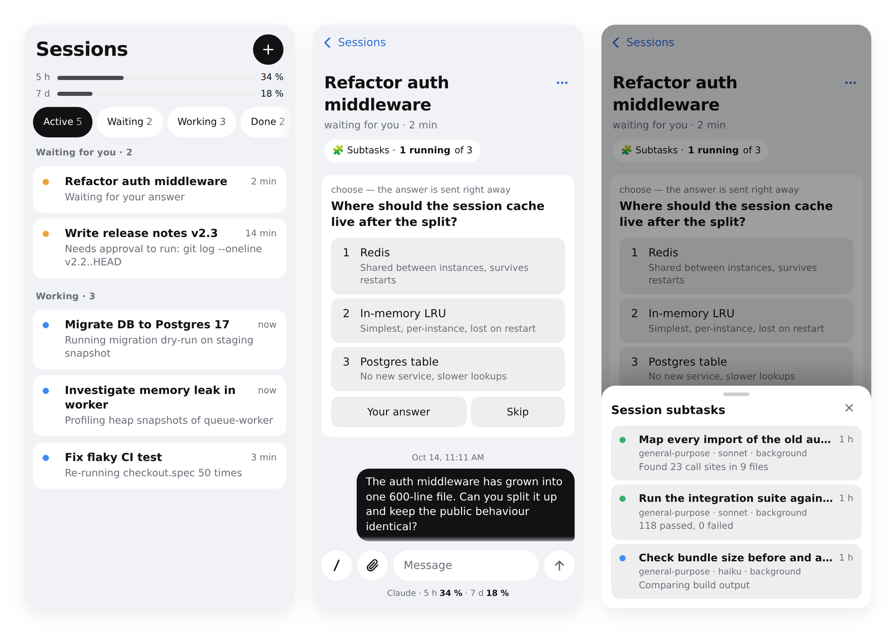
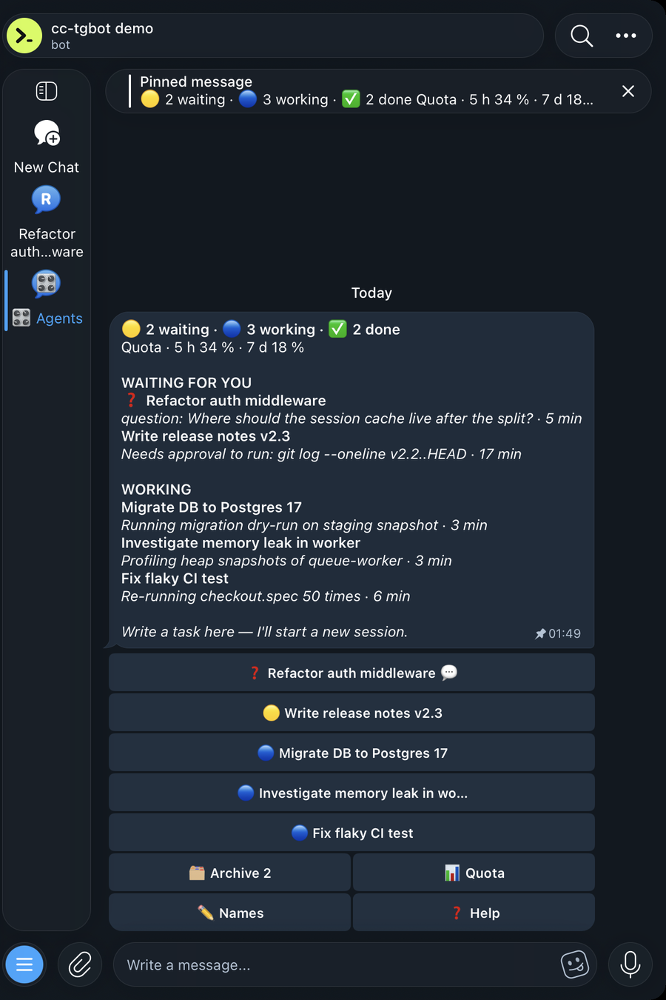
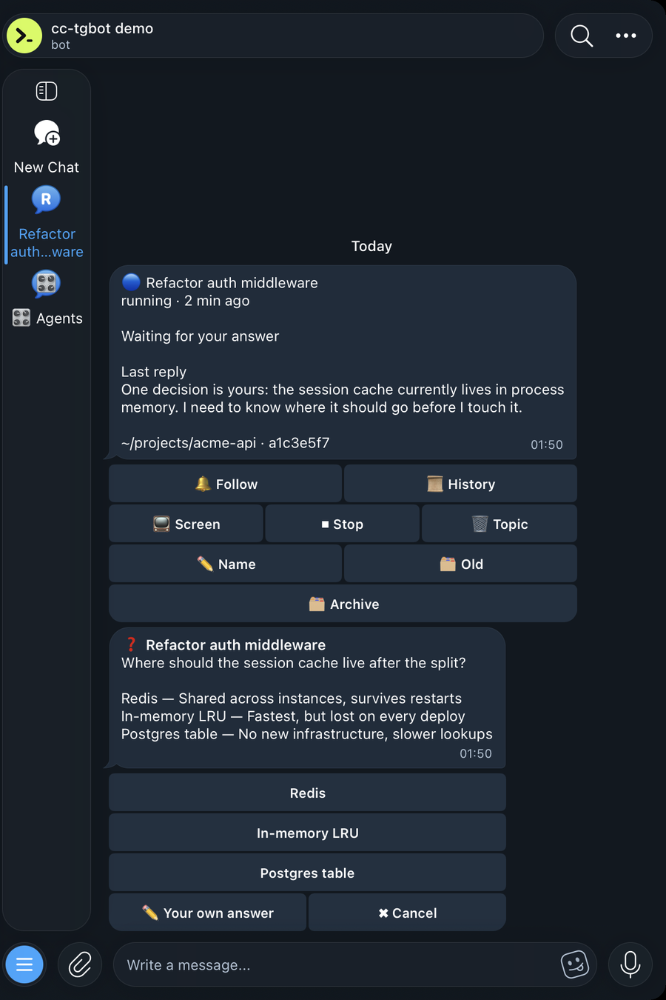
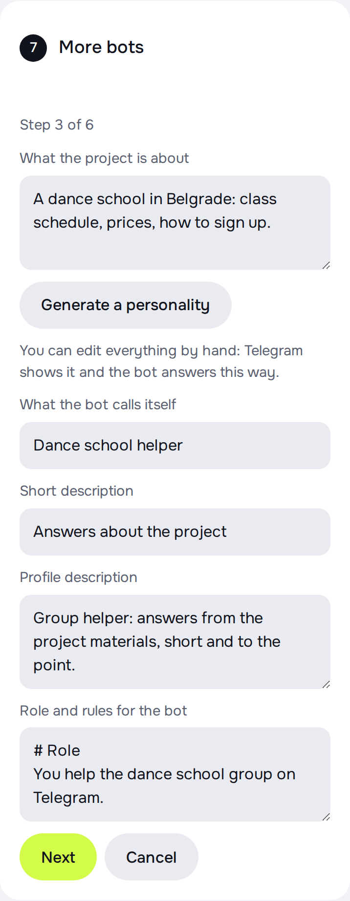
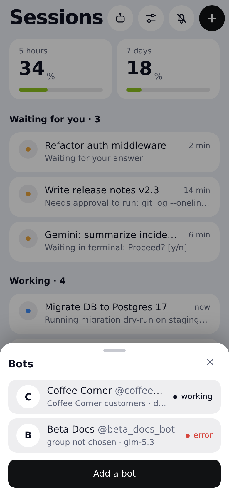

<p align="center">
  
</p>

<h1 align="center">Zidos Pager</h1>

<p align="center">Фоновые сессии Claude Code — в кармане.</p>

<p align="center">
  <a href="LICENSE"></a>
  
  
  
</p>

<p align="center"><a href="README.md">English</a> · <a href="README.ru.md">Русский</a></p>

<p align="center">
  <picture>
    <source media="(prefers-color-scheme: dark)" srcset="docs/hero-dark.png">
    
  </picture>
</p>

## Скачать

| Система | Файл | Что будет |
|---|---|---|
| macOS (Apple silicon) | [zidos-pager-Setup-macos-arm64.dmg](https://github.com/zidos-dev/pager/releases/latest/download/zidos-pager-Setup-macos-arm64.dmg) | Откройте приложение: в браузере запустится мастер установки |
| macOS (Intel) | [zidos-pager-Setup-macos-x86_64.dmg](https://github.com/zidos-dev/pager/releases/latest/download/zidos-pager-Setup-macos-x86_64.dmg) | То же |
| Windows | [zidos-pager-Setup-windows.exe](https://github.com/zidos-dev/pager/releases/latest/download/zidos-pager-Setup-windows.exe) | В браузере запустится мастер установки |
| Linux / сервер | [zidos-pager-linux.tar.gz](https://github.com/zidos-dev/pager/releases/latest/download/zidos-pager-linux.tar.gz) или `git clone` | Распакуйте и выполните `python3 setup.py` |

macOS скажет, что не может проверить разработчика: откройте Системные настройки → Конфиденциальность и безопасность и нажмите «Всё равно открыть», либо выполните `xattr -dr com.apple.quarantine "/Volumes/Zidos Pager Setup/Zidos Pager Setup.app"`. Приложение копирует свой Python в `~/.local/share/zidos-pager` — не удаляйте его, бот работает на нём.

Windows: SmartScreen может предупредить о неизвестном издателе: «Подробнее» → «Выполнить в любом случае». Сам бот работает в WSL2 (мастер ставит его туда).

Файлы можно сверить по [SHA256SUMS](https://github.com/zidos-dev/pager/releases/latest/download/SHA256SUMS).

Управляйте фоновыми сессиями [Claude Code](https://docs.claude.com/en/docs/claude-code) с телефона: Telegram-бот
с пультом в духе `claude agents`, топиками под каждую сессию, мини-аппом / устанавливаемым PWA и push-уведомлениями.
Один файл на Python, только стандартная библиотека (`cryptography` нужна по желанию — для push).

Ещё он держит [помощников для групп](#несколько-ботов): сколько угодно ботов, у каждого свой токен, личность, папка
проекта или сайт и модель (DeepSeek, OpenRouter, GLM, Kimi, Claude или Codex). Настраиваются в мастере или в мини-аппе.

> **Проект не связан с Anthropic.** Это независимая разработка сообщества. «Claude» и «Claude Code» — товарные знаки
> их владельцев. Zidos Pager опирается на внутренние файлы Claude Code (см. [Ограничения](#ограничения)) и может
> ломаться при его обновлениях.

### В Telegram

<p align="center">
  
  
</p>

## Возможности

- **Пульт как `claude agents`** — одно самообновляющееся закреплённое сообщение: сессии по группам («Ждут вас»,
  «В работе», архив), счётчики, строка квоты, страницы, режимы квоты, справки, имён и очистки.
- **Топики** — в «режиме тем» Telegram каждая открытая, созданная или отслеживаемая сессия получает свой топик:
  пишете в топик, ответы приходят в него же, название отражает состояние. Топики завершённых сессий убираются сами.
- **Мини-апп / PWA** — список сессий с историей, навигатор по сабтаскам, файлы, слеш-команды, экран терминала и
  клавиши. Устанавливается на телефон, работает вне Telegram по одноразовой ссылке входа.
- **SDK-сессии (по желанию)** — отдельный раннер запускает headless-сессии по API-ключу Anthropic: разрешения на
  инструменты приходят сообщениями 🔐 с кнопками *Разрешить / Всегда / Отклонить*, вопросы — кнопками, стоимость и
  бюджет (💲, «+1 $ и продолжить») — в карточке. Эти сессии оплачиваются по тарифу API, а не подписки; ключ
  передаётся CLI через команду `apiKeyHelper` и не попадает в окружение инструментов агента.
  Или выберите **Claude Code** в листе «Модель» мини-аппа: без ключа, сессии работают через вход CLI на сервере
  (`claude auth login`, ваша подписка Claude), модель — кнопками Opus, Sonnet или Haiku.
  Протокол: [`docs/sdk-protocol.md`](docs/sdk-protocol.md). Работает и без Claude Code — см.
  [Без Claude Code](docs/manual-install.ru.md#без-claude-code-только-sdk).
- **Вопросы кнопками** — вопросы `AskUserQuestion` (один/несколько вариантов, «свой ответ», проверка и отправка)
  отвечаются кнопками в чате или в мини-аппе.
- **Файлы в обе стороны** — документ/фото/голосовое в сессию (сохраняются в `~/tg-inbox`), файлы из ответов сессии
  обратно, а из самой сессии — `cc-send <файл>`.
- **Архив и цепочки хендоффов** — сессии «продолжение по файлу-передаче» связываются, нумеруются и скрываются из
  активного списка; готовые сессии можно убрать в архив (разговор остаётся на диске).
- **Автоимена** — короткие имена сессий от Claude (пачкой через `claude -p`), применяются командой `/rename`.
- **Уведомления по выбору** — подписка на сессию; при подписанном устройстве Web Push заменяет сообщения в Telegram.
- **Помощники для групп** — сколько угодно ботов в одной установке: у каждого свой токен, личность (её пишет модель
  по описанию проекта), папка или git-репозиторий, сайт, группа и модель со своим ключом. См. [Несколько ботов](#несколько-ботов).
- Интерфейс на **английском и русском** (`CC_LANG`).

## Требования

- Linux или macOS с **Python 3.12+**, **tmux** и **CLI `claude`** (Claude Code с `claude agents`, `claude attach`,
  `claude --bg`) — либо, только для SDK-сессий, вообще без Claude Code (см. [в руководстве](docs/manual-install.ru.md#без-claude-code-только-sdk)).
- Токен бота от [@BotFather](https://t.me/BotFather).
- По желанию: пакет `cryptography` (Web Push), `cloudflared` (публичный https-адрес для мини-аппа/PWA).

## Быстрый старт

**На Mac, если у вас архив `zidos-pager.tar.gz`:**

1. Дважды щёлкните архив в Finder: появится папка `zidos-pager`. Перенесите её в свою домашнюю папку (значок домика
   в боковой панели Finder).
2. Откройте Терминал: ⌘ + пробел, наберите «Терминал», Enter.
3. Вставьте и нажмите Enter:
   ```bash
   cd ~/zidos-pager && python3 setup.py
   ```
   Если macOS предложит установить «инструменты командной строки», согласитесь и потом повторите команду.

**На Windows** бот работает внутри WSL2 — встроенного в Windows Linux: только там есть песочница, в которой бот
выполняет команды гостей. Установите Python с [python.org](https://www.python.org/downloads/windows/), распакуйте
архив и запустите в PowerShell `cd $HOME\zidos-pager; py setup.py`. Если WSL ещё нет, мастер покажет команду
`wsl --install -d Ubuntu` (после неё нужна перезагрузка). Мастер сам добавит задачу Windows, чтобы бот работал без
открытого окна. Режим «Сервер по SSH» на Windows работает только по SSH-ключу.

**Из репозитория:** `git clone https://github.com/zidos-dev/pager ~/zidos-pager && cd ~/zidos-pager && python3 setup.py`.

Откроется браузер с мастером. Он работает только на вашем компьютере, ничего не публикует. Семь шагов, последний необязательный:

1. **Куда поставить.** «Этот компьютер» — бот работает на вашем Mac (выбрано сразу). «Сервер по SSH» нужен, только
   если у вас есть Linux-сервер, который всегда включён.
2. **Бот.** В Telegram найдите [@BotFather](https://t.me/BotFather) — это официальный бот Telegram для создания
   ботов. Отправьте ему `/newbot`, придумайте имя и адрес, который заканчивается на `bot`. В ответ придёт токен —
   длинная строка вида `123456789:AA…`. Скопируйте её в мастер.
3. **Вы.** Напишите своему боту `/start`: так он узнаёт ваш Telegram id и слушается только вас.
4. **Модель.** DeepSeek, GLM, Kimi, OpenRouter, Claude или свой адрес; вставьте ключ. Ключ проверяется до установки.
5. **Группа и знания** (необязательно). Добавьте бота в группу и напишите там что-нибудь — она появится в списке.
   Папка с материалами — это файлы, по которым бот отвечает (документы, заметки); путь можно скопировать в Finder:
   выделите папку и нажмите ⌥⌘C. Имя и роль задают, как бот представляется и как отвечает.
6. **Установка.** Мастер ставит бота, показывает журнал и в конце присылает вам пробное сообщение.
7. **Ещё боты** (необязательно). Для каждого: токен, модель и ключ, личность, папка и сайт, группа. Подробнее ниже.

Чтобы поменять модель или группу, запустите `python3 setup.py` ещё раз: мастер обновит настройки.

**Python на Mac.** Мастер запускается системным Python, а самому боту нужен Python 3.10 или новее. Если его нет,
мастер скажет об этом на первом шаге. Проще всего поставить его с [python.org](https://www.python.org/downloads/macos/)
(обычный установщик .pkg) или, если у вас есть Homebrew, командой `brew install python@3.12`.

**Бот отвечает, пока Mac не спит.** На MacBook: Системные настройки → Аккумулятор → Параметры → «Предотвращать
автоматический переход в режим сна при питании от сети, когда дисплей выключен». С закрытой крышкой Mac засыпает
всё равно (кроме работы с внешним монитором). Для работы 24/7 лучше сервер. Службы ставятся в `~/Library/LaunchAgents` (`dev.zidos.pager.bot`, `dev.zidos.pager.sdk`), журналы — в
`~/Library/Logs/zidos-pager`.

**На Linux-сервере нужно:** `python3` 3.10 или новее, `bubblewrap`, `socat` и пользовательская сессия systemd.
Если чего-то не хватает, мастер покажет точную команду установки.

Командная строка вместо мастера — в [ручной установке](docs/manual-install.ru.md): `deploy/setup-macos.sh`,
`deploy/setup.sh` и их флаги, групповой помощник на другой модели, публикация мини-аппа и режим только SDK.

## Несколько ботов

<p align="center">
  <picture><source media="(prefers-color-scheme: dark)" srcset="docs/screenshots/wizard-bots-dark.png"></picture>
  <picture><source media="(prefers-color-scheme: dark)" srcset="docs/screenshots/bots-dark.png"></picture>
</p>

Одна установка держит сколько угодно помощников для групп. У каждого свой токен Telegram, личность, папка проекта
(или git-репозиторий) и сайт, модель и ключ. Добавлять ботов можно в мастере (шаг «Ещё боты» после установки) или
в мини-аппе (кнопка с роботом, «Боты»), там же их можно удалить.

- **Личность.** Опишите проект в паре строк и нажмите «Сгенерировать»: модель самого бота напишет имя, короткое
  описание, роль, тон и правила. Всё можно поправить руками. Имя и описания попадают и в Telegram.
- **Контекст.** Папка, по которой бот отвечает (git-репозиторий перед ответом обновляется), сайт, который ему можно
  открывать (необязательно), и группа, где он отвечает. Новый бот начинает с пустой папки
  `~/zidos-pager-knowledge/<бот>`, а не с вашего домашнего каталога.
- **Модель.** У каждого бота свой провайдер и ключ; ключ одного бота другому не виден.

Каждый бот работает отдельной парой служб (`zidos-pager-bot@<бот>`, `zidos-pager-bot-sdk@<бот>`; на Mac —
`dev.zidos.pager.bot.<бот>`, `dev.zidos.pager.sdk.<бот>`). Настройки лежат в `~/.config/zidos-pager/bots/<бот>/`. Напишите боту в
личку, чтобы увидеть его состояние; слушается он того же владельца, что и основной бот. Те же действия из командной
строки: `python3 zidos_pager.py bots list|add|save|persona|remove` (JSON на вход).

Если бот стоял до этой версии, запустите `python3 setup.py` ещё раз: мастер поставит шаблоны служб для ботов.
Удаление бота стирает его настройки и состояние, но не папку в `~/zidos-pager-knowledge`.

> Переход со старого имени cc-tgbot (legacy): запустите установщик с `--update`, мастер делает это сам. Он перенесёт `~/.config/cc-tgbot`, `~/.local/share/cc-tgbot` и `~/.local/state/cc-tgbot` в `zidos-pager` и оставит на старом месте ссылку, поэтому пути в прежних env-файлах продолжат работать, а затем заменит службы `cc-tgbot*` или LaunchAgents `com.cctgbot.*` новыми. Переменные `CC_TGBOT_ENV` и `CC_TGBOT_STATE` тоже работают.

## Настройка

Все параметры — в `~/.config/zidos-pager/env` (все переменные с комментариями — в [`env.example`](env.example)):
`TG_BOT_TOKEN`, `TG_ALLOWED_USERS`, `CC_LANG`, `CC_DEFAULT_CWD`, `CC_CLAUDE_BIN`, `CC_JOBS_DIR`, `CC_WEBAPP_URL`,
`CC_WEBAPP_PORT`, `CC_VAPID_SUB`, `CC_TOPIC_TTL_HOURS`, `CC_RATE_FILE`, `CC_CHAIN_GENERIC_DIRS` и другие.
Состояние бота — `~/.local/state/zidos-pager/state.json` (права 0600).

Команды: `/s` (пересоздать пульт), `/new`, `/quota`, `/screen`, `/stop`, `/pwa`, `/devices`, `/help`.

## Безопасность

**Прочитайте до запуска.** Любой, кто может писать боту, может заставить эту машину выполнять произвольные команды:
фоновые сессии обычно работают с отключёнными запросами разрешений, а бот печатает в них. Относитесь к токену бота,
списку разрешённых, токенам устройств и публичному адресу как к SSH-ключу.

Что сделано в проекте:

- **Только список разрешённых.** Обслуживаются лишь личные чаты и Telegram id из `TG_ALLOWED_USERS`; остальное молча
  игнорируется. Список читается только из env-файла.
- **Аутентификация мини-аппа.** `/api/*` принимает подпись Telegram `initData` (HMAC, не старше 24 ч, пользователь из
  списка) или отзываемый токен устройства (хранится хэшем, скользящий срок 90 дней и абсолютный 180, одноразовые коды
  входа, 5 попыток в минуту на IP). Статика открыта, всё остальное — за авторизацией.
- **Доступ к файлам — белый список.** Скачивать и отправлять можно только из `~/tg-inbox`, `~/code`,
  `~/.claude/jobs/*/tmp`, `/var/tmp` и `/tmp`, без каталогов с точкой, `secrets/`, `.env*`, ключей, токенов, файлов с
  паролями, истории и баз/дампов; проверка по реальному пути (симлинк не выведет наружу); ссылки подписаны и живут 10 минут.
- **Укрепление.** CSP с хэшами, `nosniff`, `no-referrer`, таймауты сокетов, лимит одновременных соединений, лимиты
  размера запросов, вычищение ESC/управляющих символов из всего, что печатается в сессию, серверный белый список
  слеш-команд, белый список хостов push (без SSRF), подписанные ссылки скрыты в журнале, `~/tg-inbox` чистится через 30 дней.
- **Журналы и Telegram.** В журнале нет текстов сообщений, токенов и `initData`. Но сообщения бота проходят через
  серверы Telegram.

От чего проект не защитит: **prompt injection** (сессия, читающая недоверенные страницы/почту, может быть перенаправлена
ими — рассмотрите отдельного пользователя или контейнер для сессий), украденный разблокированный телефон, взломанный
аккаунт Telegram. Не публикуйте адрес мини-аппа; по возможности добавьте правила Cloudflare Access/WAF для `/api/*`.
`CC_WEBAPP_DEV=1` отключает аутентификацию для локальных запросов — никогда не включайте на общей машине.

## Ограничения

- Используются **внутренние недокументированные файлы** Claude Code (`~/.claude/jobs/<id>/state.json`, транскрипты в
  `~/.claude/projects`, вывод `claude agents --json`) и разбор экрана `claude attach` через tmux. Любое обновление
  Claude Code может это сломать — после обновлений возможны правки.
- Пульт сессий Claude Code (tmux) — только Linux и macOS; групповой помощник на Windows работает внутри WSL2.
- Один экземпляр бота на токен (long polling `getUpdates`); один экземпляр — одна машина.
- Режим топиков требует тем в личных чатах Telegram; адрес быстрого туннеля меняется при перезапуске.

## Лицензия

[MIT](LICENSE) © 2026 cc-telegram contributors.
